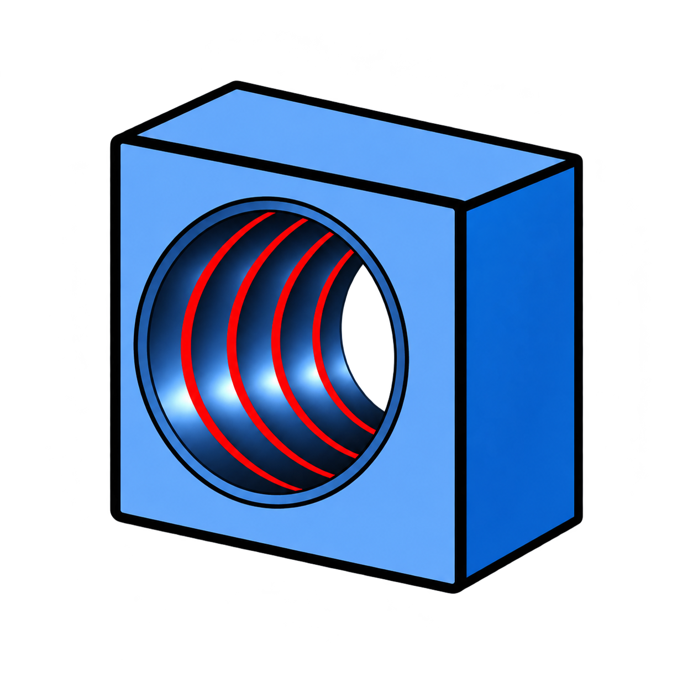
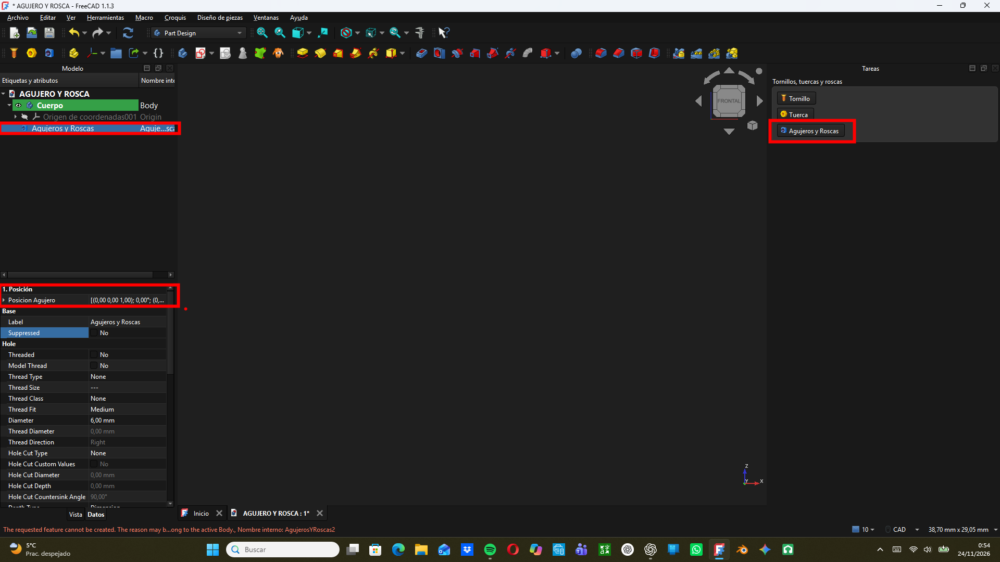
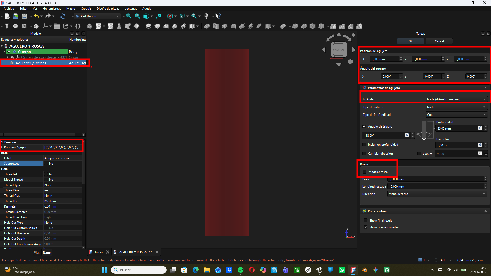
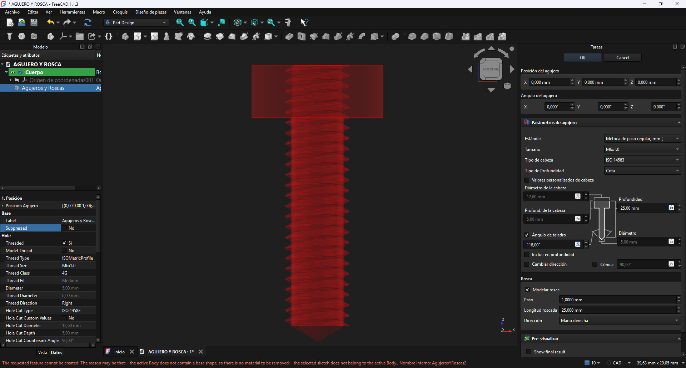
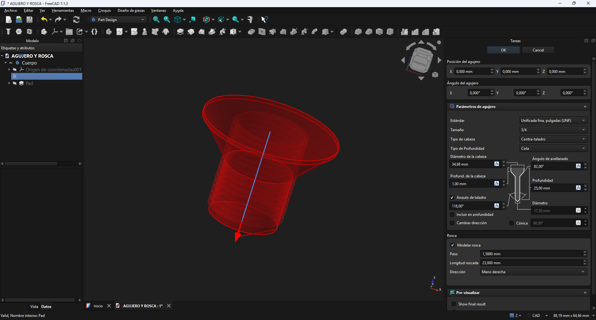
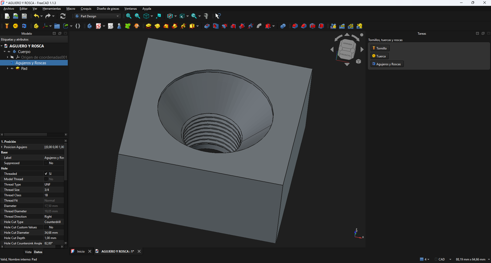
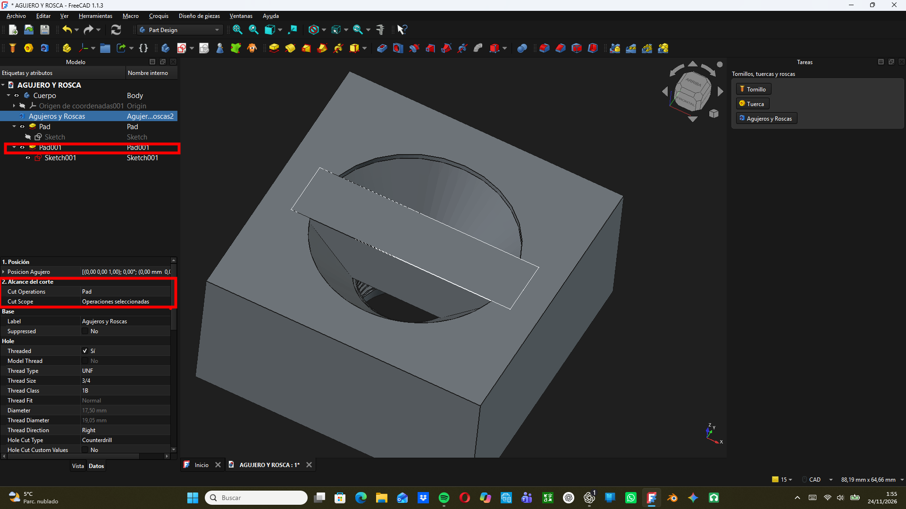
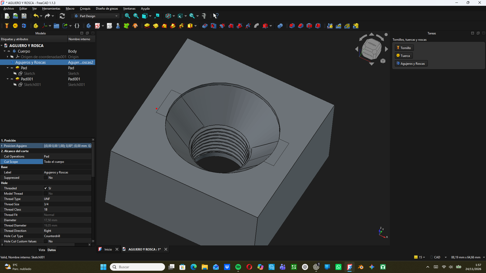

# Tutorial Agujeros y Roscas

Parte 3 de **Tornillos, Tuercas, Agujeros y Roscas (TTAR)** para Part Design de FreeCAD.

## 1. Crear o editar un agujero

Con un **Cuerpo** creado y activo, pulsa **Agujeros y Roscas** en el panel **Tareas**. Para editar un agujero existente, haz doble clic en su operación dentro del Cuerpo en el árbol.

Aunque normalmente conviene crear primero el sólido, en este ejemplo se define el agujero roscado en un Cuerpo vacío y se añade el **Pad** después.

## 2. Colocar el agujero y ajustar sus dimensiones

El agujero toma como referencia el origen del **Cuerpo** y se puede crear sin un croquis de entrada. Ajusta la **Posición del agujero** y el **Ángulo del agujero** en los ejes X, Y y Z desde **Tareas**. También puedes cambiar su colocación desde **Datos → 1. Posición → Posicion Agujero**.

Por defecto, la vista previa muestra un cilindro liso que representa el volumen del corte. El estándar inicial es **Nada (diámetro manual)**, sin tamaño de catálogo ni tipo de cabeza, y **Modelar rosca** está desactivado. Puedes editar el diámetro y la profundidad.

## 3. Configurar la rosca

Selecciona el **Estándar**, el **Tamaño** y el **Tipo de cabeza**. Activa **Modelar rosca** y ajusta el paso, la longitud roscada y la dirección en el panel **Rosca**. Si el catálogo tiene un paso para el tamaño elegido, la herramienta lo propone como valor editable.

**Ejemplo métrico.** ISO métrico regular **M6 × 1,0**, cabeza **ISO 14583** y longitud roscada de **25 mm**.

**Ejemplo en pulgadas.** **UNF de ¾″**, cabeza **Contra-taladro**, paso de **1,5880 mm** y longitud roscada de **23 mm**.

## 4. Aplicar el corte al Pad

Pulsa **OK** para guardar el agujero. Si partiste de un Cuerpo vacío, crea un **Pad** en ese mismo Cuerpo y sitúa el material donde lo atraviesa el agujero. Al confirmar el Pad, el Cuerpo se recalcula y aplica el corte con la rosca modelada.

Como el agujero se posiciona respecto al Cuerpo, puedes borrar el Pad del ejemplo y conservar el agujero para aplicarlo a un sólido posterior.

## 5. Elegir el alcance del corte

Selecciona **Agujeros y Roscas** en el árbol y abre **Datos → 2. Alcance del corte**. En **Cut Scope**, elige **Operaciones seleccionadas** y deja solo **Pad** en **Cut Operations**. El agujero corta **Pad** y **Pad001** conserva su material, formando un puente que atraviesa el vaciado.

Cambia **Cut Scope** a **Todo el cuerpo**. El agujero corta tanto **Pad** como la parte de **Pad001** que atraviesa el vaciado. La abertura queda libre y se ve la rosca interior.

