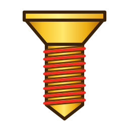
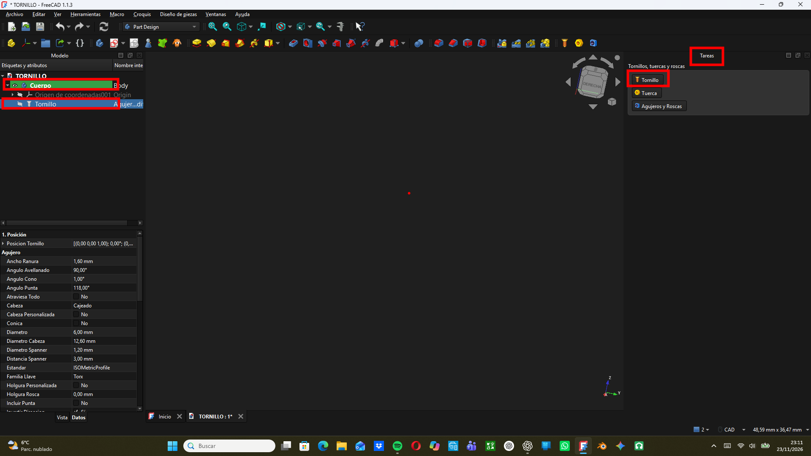
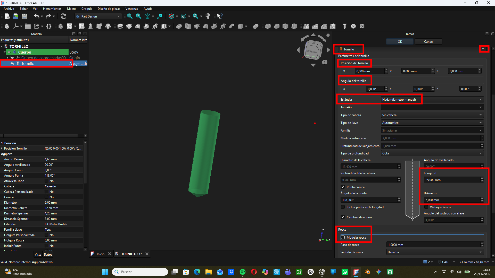
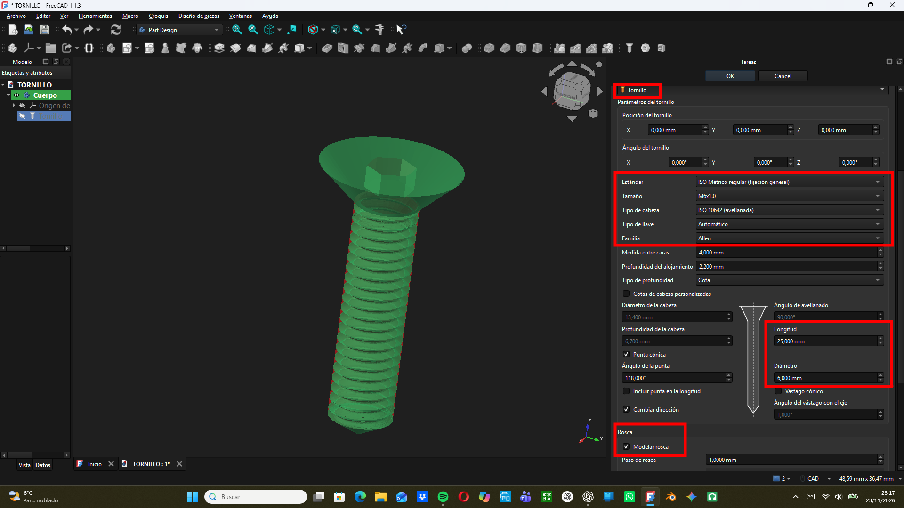
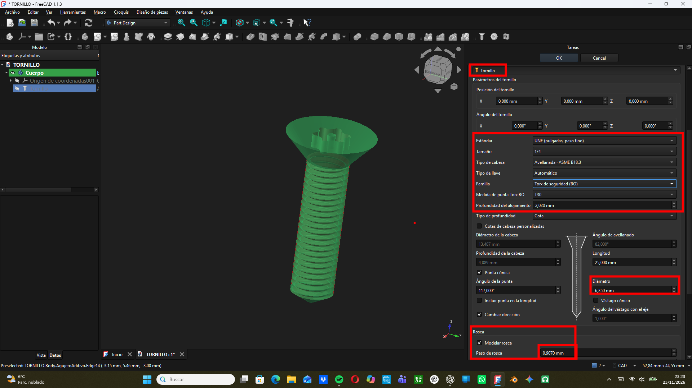
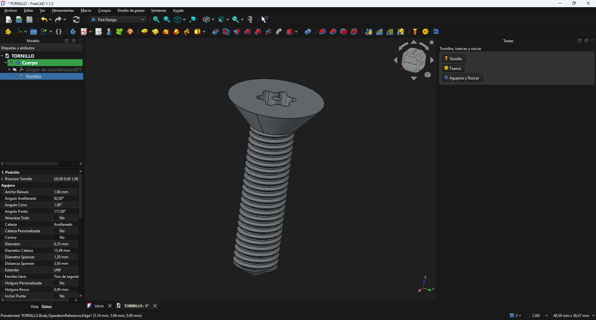

# Tutorial Tornillo

Parte 1 de **Tornillos, Tuercas, Agujeros y Roscas (TTAR)** para Part Design de FreeCAD.

## 1. Crear o editar un tornillo

Con un **Cuerpo** creado y activo, pulsa **Tornillo** en el panel **Tareas**. Para editar un tornillo existente, haz doble clic en su operación dentro del Cuerpo en el árbol.

## 2. Ajustar el vástago inicial

Por defecto, la herramienta muestra un vástago editable con **Nada (diámetro manual)** como estándar, sin tamaño de catálogo, sin cabeza y sin familia de llave asignada. **Modelar rosca** está desactivado. Puedes ajustar la posición y el ángulo en X, Y y Z, además de la longitud y el diámetro.

## 3. Elegir estándar, tamaño y cabeza

Selecciona el **Estándar**, el **Tamaño** y el **Tipo de cabeza**. Cuando hay datos para esa selección en las tablas normalizadas, la herramienta propone la familia de llave, el diámetro y el paso de rosca. Estos valores se pueden modificar. Activa **Modelar rosca** para generar la geometría de la rosca.

**Ejemplo métrico.** ISO métrico regular, tamaño **M6 × 1,0**, cabeza avellanada **ISO 10642** y llave **Allen**.

**Ejemplo en pulgadas.** **UNF de ¼″** con cabeza avellanada **ASME B18.3** y **Torx de seguridad (BO) T30**. El panel muestra un diámetro de **6,350 mm** y un paso de **0,9070 mm**.

## 4. Confirmar el resultado

Pulsa **OK**. El tornillo queda en el árbol del Cuerpo y puedes volver a editarlo con doble clic.

