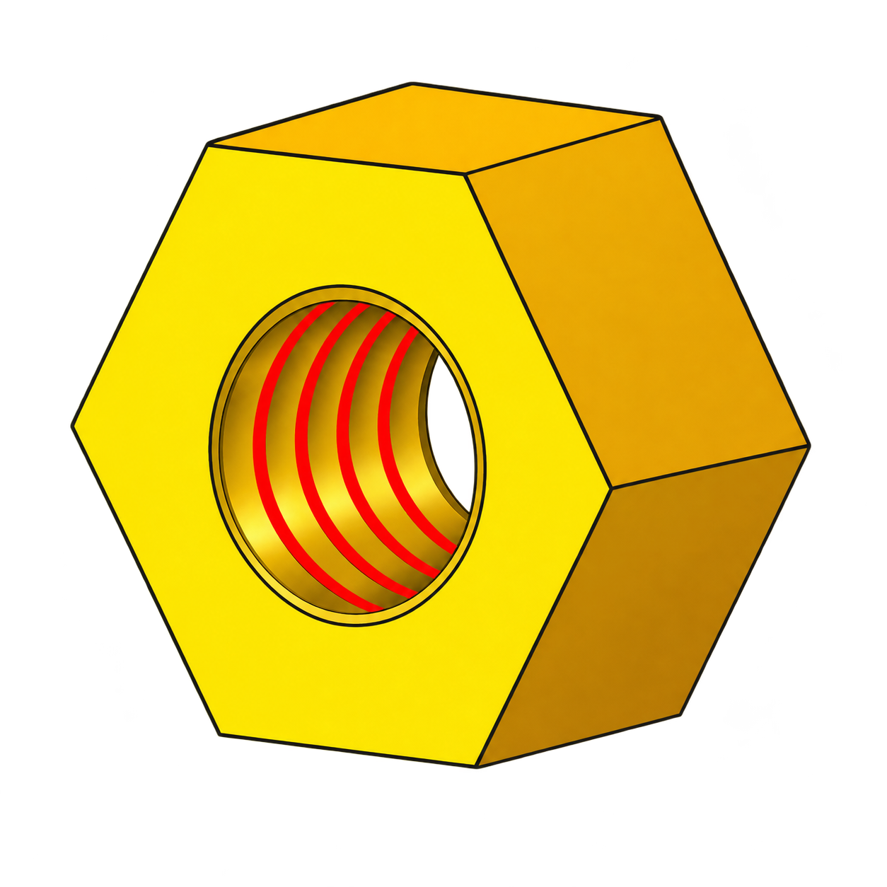
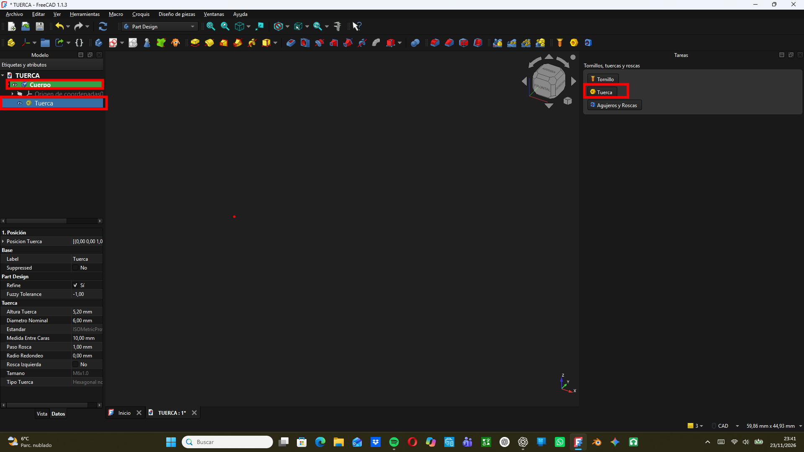
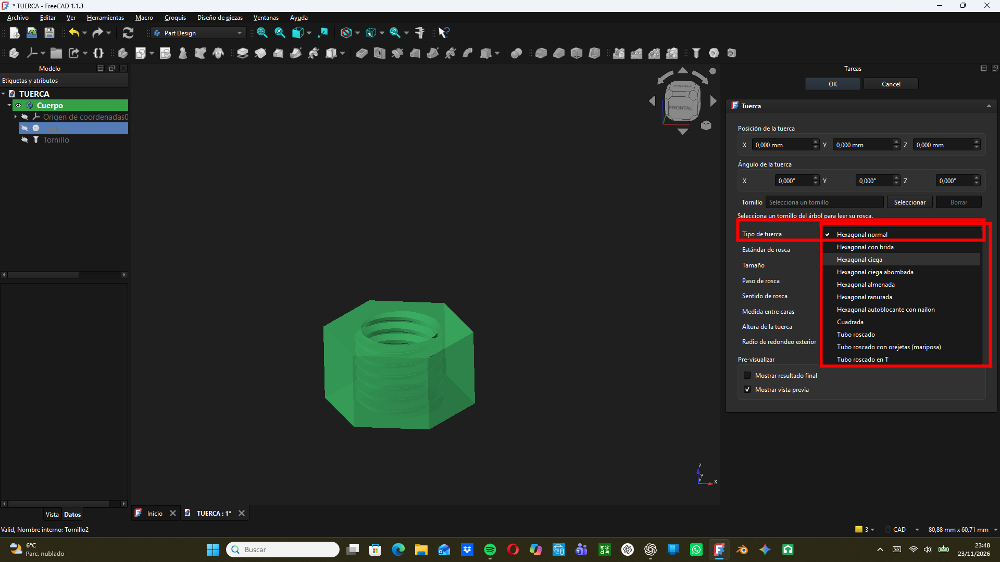
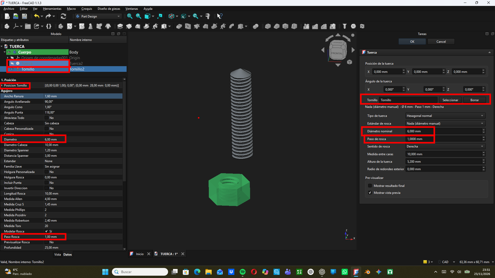
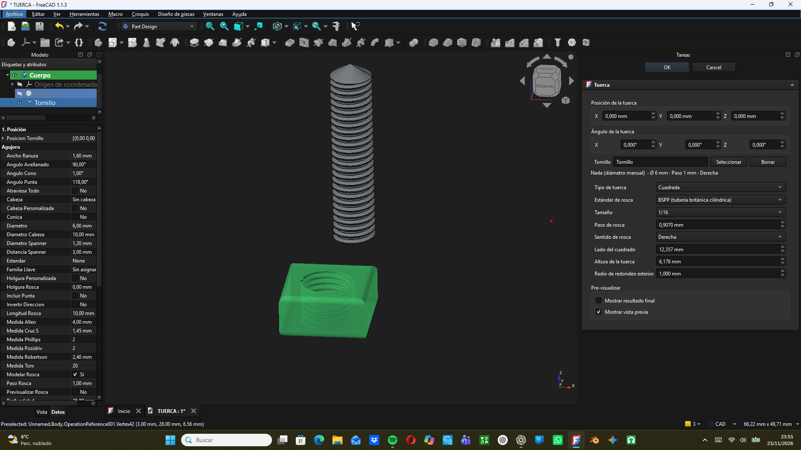
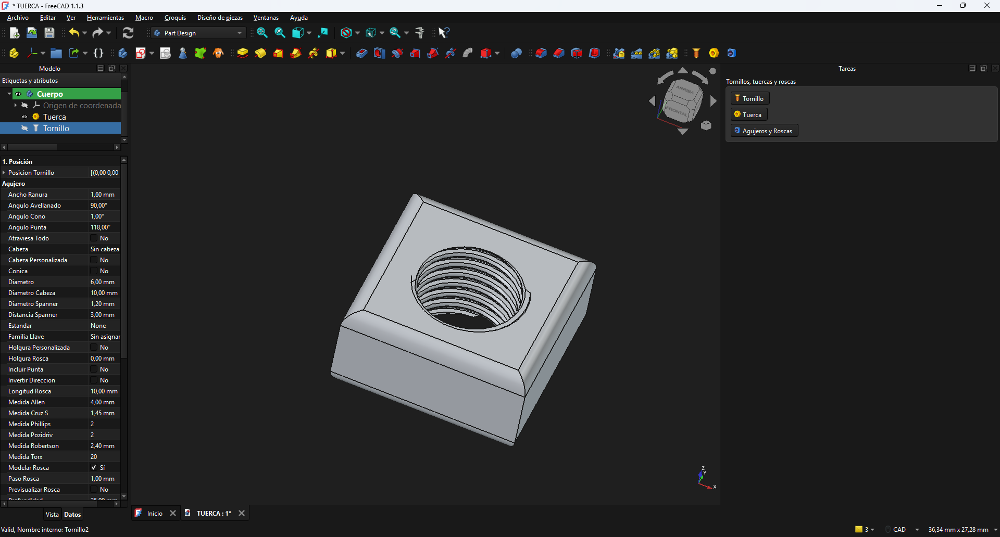

# Tutorial Tuerca

Parte 2 de **Tornillos, Tuercas, Agujeros y Roscas (TTAR)** para Part Design de FreeCAD.

## 1. Crear o editar una tuerca

Con un **Cuerpo** creado y activo, pulsa **Tuerca** en el panel **Tareas**. Para editar una tuerca existente, haz doble clic en su operación dentro del Cuerpo en el árbol.

## 2. Elegir el tipo de tuerca

Por defecto, la herramienta muestra una tuerca **Hexagonal normal**. El desplegable **Tipo de tuerca** ofrece 11 opciones: siete hexagonales, una cuadrada y tres variantes de tubo roscado (normal, con orejetas o mariposa, y en T).

## 3. Copiar el diámetro y el paso de un tornillo

En el campo **Tornillo**, pulsa **Seleccionar** y elige un tornillo ya creado en el árbol. La herramienta toma de él el diámetro y el paso de rosca. En la captura, la tuerca recibe un diámetro nominal de **6 mm** y un paso de **1 mm**.

## 4. Ajustar el estándar y el tamaño

Elige el **Tipo de tuerca**, el **Estándar de rosca** y el **Tamaño**. Cuando hay datos para esa selección en las tablas normalizadas, la herramienta rellena parámetros como el paso de rosca. Puedes ajustar manualmente las cotas editables.

En este ejemplo, una tuerca **Cuadrada** con rosca **BSPP de 1/16″** tiene un paso de **0,9070 mm**.

## 5. Confirmar el resultado

Pulsa **OK**. La tuerca queda en el árbol del Cuerpo y puedes volver a editarla con doble clic.

